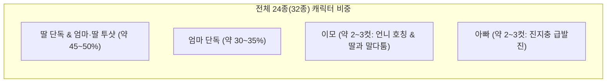

# 카카오톡 움직이는 이모티콘 제안 기획안: <우당탕탕 우리 가족(가제)>

가족 단톡방에서 매일 쓰기 좋으면서도, **엄마(불같은 다정함) + 9살 딸(예의 바른 척 & 킹받는 반말)** 중심(80%)에 **이모("언니라 불러!")**와 **아빠(진지충 급발진)**가 감초로 등장하는 맞춤형 이모티콘 기획안입니다.

---

## 1. 카카오 이모티콘 스튜디오 제안서 입력 가이드

스튜디오 제안 페이지에 바로 복사·수정해서 넣을 수 있는 항목별 초안입니다.

### ① 이모티콘 제목 후보 (5선)
> [!TIP]
> 카카오 이모티콘 제목은 **타겟(가족/엄마/딸)**이나 **캐릭터 성격(킹받는, 우당탕탕)**이 직관적으로 드러날수록 검색과 노출에 유리합니다.

1. **우당탕탕 불꽃 엄마와 킹받는 딸** *(캐릭터 대비 강조)*
2. **예의 바른 척? 9살 딸과 매운맛 가족들** *(딸 캐릭터성 강조)*
3. **사랑이 넘치는(하지만 화도 넘치는) 우리 가족** *(가족 공감형)*
4. **엄마랑 딸이랑! 찐친 패밀리 단톡방** *(단톡방 실용성 강조)*
5. **화끈한 엄마, 얄미운 딸, 그리고 언니(?) 이모** *(스토리텔링형)*

### ② 이모티콘 시리즈 설명 (제안서 복사용)
> 정은 많지만 불같이 화를 잘 내는 엄마, 세상 예의 바른 척하다가도 킹받는 반말로 깐족대는 9살 딸!  
> 여기에 딸에게 "이모 말고 언니라고 불러!"라며 티격태격하는 베프 이모와, 시도 때도 없이 진지하게 급발진하는 아빠까지.  
> 함께 여행 다니며 찐친처럼 지내는 4인 4색 가족의 유쾌한 일상 대화와 리액션을 가족 단톡방에서 생생하게 표현할 수 있는 움직이는 이모티콘입니다.

### ③ 캐릭터 비율 및 디자인 포인트 (Toon 스타일 변환 시 핵심)

> [!IMPORTANT]
> **실사 사진 → Toon 캐릭터 변환 시 승인율을 높이는 팁**
> 1. **그림체 통일감**: 사진을 AI/필터로 단순 변환한 느낌보다, **4명의 외곽선 두께(예: 굵은 검정/갈색 펜선), 눈동자 표현, 2~3등신 비율(SD 캐릭터)**을 통일해야 카카오 심사에서 '완성도 있는 캐릭터'로 인정받습니다.
> 2. **시그니처 아이템 고정**: 누가 봐도 구분되도록 캐릭터별 고정 특징을 주세요.
>    - **엄마**: 하트 앞치마 또는 편한 홈웨어 + 화날 때 머리 위로 솟는 불꽃/스팀
>    - **딸 (9살)**: 양갈래 또는 똑단발 + 예의 바른 척할 때 반짝이는 눈망울 vs 킹받을 때 반쯤 감긴 눈
>    - **이모**: 화려한 선글라스나 힙한 착장 (스스로 '언니'라고 우기는 포인트)
>    - **아빠**: 안경 치켜올리기(진지할 때 안경 빛 반사) 또는 진지한 턱 괴기 포즈

---

## 2. 움직이는 이모티콘 24종 핵심 기획안 (제안 제출용)

카카오 **움직이는 이모티콘 제안 규격은 총 24종(GIF 3종 + PNG 21종)**입니다.  
- **비중 구성 (24종 기준)**: 딸 단독(9종) + 엄마 단독(7종) + 엄마&딸 투샷(3종) = **19종 (79.2%)** / 이모(2종) / 아빠(2종) / 4인 가족 완전체(1종)
- **★ GIF 대표 시안 추천 (3종)**: 움직임이 가장 역동적이고 캐릭터 성격이 확 드러나는 **2번(엄마 극대노), 8번(딸 킹받는 춤), 20번(이모 vs 딸 말다툼)** 또는 **24번(넷이 여행 출발)**을 추천합니다.

| 번호 | 등장 인물 | 텍스트 (1~2줄) | 표정 및 동작(모션) 연출 | 단톡방 활용 상황 |
| :---: | :---: | :--- | :--- | :--- |
| **01** | **딸** | **다녀오겠습니다~ (꾸벅)** | 두 손 모으고 90도로 세상 예의 바르게 인사하며 머리 주변에 꽃이 피어남 | 등교/외출 인사, 모범생 코스프레 |
| **02** ★GIF | **엄마** | **누가 그랬어?!** | 다정하게 웃던 얼굴이 0.5초 만에 화산처럼 폭발하며 머리 뒤로 불길이 치솟음 | 잔소리 시작 전, 범인 색출할 때 |
| **03** | **딸** | **응~ 아니야~** | 코를 후비거나 턱을 괴고 눈을 반쯤 감은 채 고개를 까딱까딱 흔듦 (킹받는 표정) | 엄마/이모 말에 깐족거리며 반박할 때 |
| **04** | **엄마** | **밥 먹어!! ♥** | 표정은 아직 화난 것처럼 눈썹이 치켜올라가 있는데, 양손으로는 거대한 국자와 하트 밥공기를 들이밈 (츤데레 정) | 식사 호출, 츤데레 애정 표현 |
| **05** | **딸** | **네네~ 알겠습니당** | 입으로는 대답하며 경례하지만 발은 이미 딴청 피우며 엉덩이를 실룩거림 | 잔소리에 영혼 없이 대답할 때 |
| **06** | **엄마** | **하... 참자 참아** | 이마를 짚고 심호흡하며 머리 위에 '인내심 게이지'가 빨갛게 깜빡거림 | 화를 꾹 누를 때, 빡침 예고 |
| **07** | **딸** | **엄마 최고! (용돈 좀..)** | 초롱초롱한 눈망울로 엄마 다리에 매달려 볼을 부비적거림 (두 번째 줄 텍스트는 작게) | 부탁할 게 있을 때, 아부 모드 |
| **08** ★GIF | **딸** | **약오르지~ 메롱!** | 엉덩이를 좌우로 씰룩거리며 혀를 쏙 내밀고 얄밉게 탭댄스를 춤 | 약 올릴 때, 내기 이겼을 때 |
| **09** | **엄마** | **어디야? 빨리 와!** | 시계를 톡톡 두드리며 발을 동동 구르고 눈에서 레이저가 나감 | 귀가 재촉, 약속 시간 늦었을 때 |
| **10** | **딸** | **어쩔티비~ (모른 척)** | 선글라스를 쓱 내리며 귀를 후비적거리고 휘파람을 붇 | 불리한 질문 무시할 때 |
| **11** | **엄마** | **아이구 내 새끼~♥** | 불같던 모습은 온데간데없이 꿀 떨어지는 눈으로 와락 껴안으며 하트가 펑펑 터짐 | 칭찬할 때, 다정한 엄마 모드 |
| **12** | **딸** | **죄송합니다아... (힐끔)** | 무릎 꿇고 두 손 들고 벌서는 척하면서 한쪽 눈을 살짝 떠서 엄마 눈치를 봄 | 잘못했을 때, 눈치 보기 |
| **13** | **엄마** | **등짝 스매싱 간다!** | 손바닥에 불꽃 이펙트가 타오르며 팔을 걷어붙이고 다가옴 | 강력한 경고, 혼쭐낼 때 |
| **14** | **딸** | **이거 사주세용♥** | 세상 공손하게 두 손을 모으고 고양이처럼 애교 윙크를 날림 | 쇼핑/간식 조를 때 |
| **15** | **엄마** | **오구오구 잘했어!** | 양손 엄지척을 날리며 물개박수를 치고 배경에 반짝이 효과 | 가족 단톡방 칭찬/응원 리액션 |
| **16** | **딸** | **피곤해.. 건들지 마** | 바닥에 액체처럼 녹아내려 대자로 뻗은 채 영혼이 입에서 빠져나감 | 방전됐을 때, 학교/학원 끝나고 |
| **17** | **엄마 & 딸** | **우리가 누구? 환상의 콤비!** | 엄마와 딸이 똑같은 선글라스를 끼고 하이파이브하며 궁디팡팡 춤을 춤 | 모녀 단합, 의견 일치할 때 |
| **18** | **엄마 & 딸** | **찌릿... 흥!** | 엄마는 팔짱 끼고, 딸은 입을 삐죽 내민 채 서로 등을 돌리고 콧방귀(흥!)를 뀜 | 서로 삐졌을 때, 투닥거린 직후 |
| **19** | **엄마 & 딸** | **오늘 뭐 먹지?!** | 엄마와 딸이 동시에 숟가락·포크를 들고 침을 꼴깍 삼키며 눈을 반짝임 | 외식 메뉴 정할 때, 야식 타임 |
| **20** ★GIF | **이모 (단독)** | **이모 아냐! 언니라고 불러!** | 화려하게 머리를 쓸어 넘기며 손가락을 까딱이고 윙크 (옆에 작은 글씨로 '양심 어디?') | 이모의 시그니처 등장, 나이 부정 |
| **21** | **이모 & 딸** | **언니는 무슨~ / 야!!** | 딸이 킹받는 표정으로 혀를 내밀자 이모가 발끈해서 이마를 맞대고 불꽃 튀는 눈싸움 | 이모와 조카(딸)의 찐친 말다툼 |
| **22** | **아빠 (단독)** | **아빠가 살아보니까 말이야...** | 갑자기 배경이 어두워지며 안경에 흰 빛이 반사되고 진지하게 턱을 괴고 고개를 끄덕임 | 진지충 모드, 갑분싸 명언 타임 |
| **23** | **아빠 (단독)** | **지금 당장 출발한다!!** | 아무 일도 없는데 혼자 비장하게 핸들을 잡거나 짐가방을 메고 전력 질주 (급발진) | 아빠의 급발진, 추진력 폭발할 때 |
| **24** | **4인 완전체** | **떠나자! 우리 넷이 가족이다♥** | 엄마·딸·아빠·이모 넷이 캐리어를 끌거나 오픈카를 타고 신나게 만세하며 점프 | 가족+이모 여행 출발, 단톡방 총집합 |

---

## 3. 추가 확장 8종 기획안 (총 32종 구성 시 25~32번)

멈춰있는 이모티콘(32종)으로 동시 제안하거나, 제작 시 선택의 폭을 넓히기 위한 **추가 8종**입니다. (32종 전체 기준에서도 엄마·딸 비중 약 80% 유지)

| 번호 | 등장 인물 | 텍스트 (1~2줄) | 표정 및 동작(모션) 연출 | 단톡방 활용 상황 |
| :---: | :---: | :--- | :--- | :--- |
| **25** | **딸** | **크하하! 내가 이겼다!** | 두 팔을 허리에 얹고 뒤로 넘어가듯 호탕하고 얄밉게 웃음 | 게임/내기 승리, 기세등등할 때 |
| **26** | **엄마** | **내가 못 살아 진짜~** | 화내다가도 어이없어서 피식 웃으며 손사래를 침 | 어이없지만 귀여워서 봐줄 때 |
| **27** | **딸** | **할 말 하않... (절레절레)** | 한숨을 푹 쉬며 어른처럼 고개를 절레절레 흔듦 | 아빠 진지충 모드나 엄마 잔소리 반응 |
| **28** | **엄마** | **용돈 입금 완료!** | 선글라스를 끼고 돈다발(또는 카드)을 멋지게 슈슉 날림 | 용돈/송금 보낼 때 가족 단톡 필수템 |
| **29** | **딸** | **감사합니다 충성충성^^7** | 빛의 속도로 각 잡힌 거수경례를 하며 눈이 하트로 변함 | 용돈 받았을 때, 선물 받았을 때 |
| **30** | **엄마 & 딸** | **잘 자~ 굿나잇♥** | 엄마와 딸이 나란히 이불을 덮고 코 골며 침 방울을 부풀림 | 밤 인사, 취침 알림 |
| **31** | **이모** | **이모(언니)가 쏜다!!** | 멋지게 카드를 꺼내 흔들며 선글라스 너머로 윙크 | 이모가 맛있는 거 사줄 때, 약속 잡을 때 |
| **32** | **아빠** | **그건 과학적으로 불가능해.** | 갑자기 칠판 막대기를 들고 진지하게 설명하며 혼자 과몰입 | 농담에 다큐로 받아칠 때 (진지충 개그) |

---

## 4. 다음 단계로 바로 진행해 볼 수 있는 작업

1. **캐릭터 Toon 시안 생성 테스트**:
   - 네 분(엄마, 딸, 이모, 아빠)의 특징(헤어스타일, 안경 유무, 자주 입는 옷 색상 등)을 알려주시거나 참고 사진을 주시면, **이모티콘용 2~3등신 Toon 스타일 캐릭터 시트와 대표 컷 이미지**를 바로 생성해 드릴 수 있습니다.
2. **움직이는 GIF & 360×360 규격 변환기 제작**:
   - 만들어진 이미지를 넣으면 카카오톡 채팅방 배경에서 미리 보고, **360×360 px 규격 및 흰색 테두리/움직이는 GIF 애니메이션**으로 자동 변환해 주는 전용 웹 툴을 만들어 드릴 수 있습니다.
